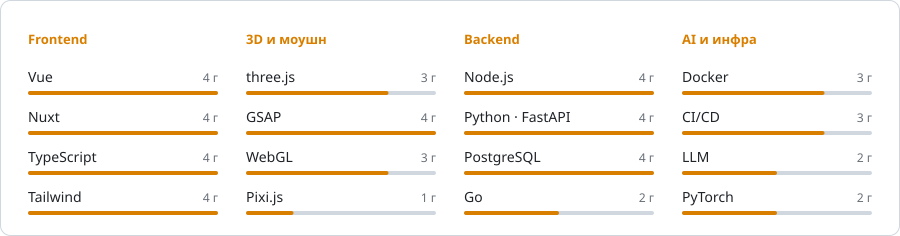

## Марк · hunadev

Фронтенд-разработчик. Делаю сайты, сервисы и Telegram-ботов.

### Стек

<table>
  <tr>
    <td><b>Frontend</b></td>
    <td></td>
  </tr>
  <tr>
    <td><b>3D и моушн</b></td>
    <td>&nbsp; GSAP · WebGL · Pixi.js</td>
  </tr>
  <tr>
    <td><b>Backend</b></td>
    <td></td>
  </tr>
  <tr>
    <td><b>Базы и очереди</b></td>
    <td></td>
  </tr>
  <tr>
    <td><b>AI</b></td>
    <td>&nbsp; LLM · OpenRouter · распознавание по фото · голос</td>
  </tr>
  <tr>
    <td><b>Боты</b></td>
    <td>aiogram · grammY · Telegram Mini Apps · TON Connect</td>
  </tr>
  <tr>
    <td><b>Desktop</b></td>
    <td></td>
  </tr>
  <tr>
    <td><b>DevOps</b></td>
    <td></td>
  </tr>
</table>

<picture>
  <source media="(prefers-color-scheme: dark)" srcset="assets/stack-dark.svg"/>
  
</picture>

### Проекты

- **[Avalin](https://travel.avalin.space)** — ИИ-маршруты и винные туры по югу России · `Nuxt 4` `LLM` `PWA`
- **[SCANURIK](https://dash.scanurik.com)** — мониторинг Avito в реальном времени · `Nuxt 4` `Telegram Mini App` `Push`
- **[CHINDOCAR](https://cars-frontend-nu.vercel.app)** — авто из Кореи напрямую · `Nuxt 4` `Go` `Kafka`
- **[Proxyvizr](https://proxyvizr.com)** — маркетплейс прокси с оплатой криптой · `Nuxt` `Telegram Mini App`
- **[Hall of Doors](https://escape-from-the-ban.vercel.app)** — игра в Telegram с выигрышем в TON · `PixiJS` `TON Connect`
- **[Отчётинатор](https://t.me/otchetinatorbot)** — бот, который оформляет работы по ГОСТу · `Python` `aiogram` `LLM`

### Активность

<picture>
  <source media="(prefers-color-scheme: dark)" srcset="https://streak-stats.demolab.com?user=hunamuna123&theme=github-dark-blue&background=0d1117&ring=ffb547&fire=ffb547&currStreakLabel=ffb547&hide_border=true&border_radius=10&locale=ru"/>
  
</picture>

<picture>
  <source media="(prefers-color-scheme: dark)" srcset="https://raw.githubusercontent.com/hunamuna123/hunamuna123/output/snake-dark.svg"/>
  
</picture>

---

Telegram: [@hunamuna123](https://t.me/hunamuna123) · канал [@hunadev](https://t.me/hunadev)
