&nbsp;

### `~/stack`

### `~/activity`

<picture>
  <source media="(prefers-color-scheme: dark)" srcset="https://raw.githubusercontent.com/hunamuna123/hunamuna123/output/snake-dark.svg"/>
  <source media="(prefers-color-scheme: light)" srcset="https://raw.githubusercontent.com/hunamuna123/hunamuna123/output/snake-light.svg"/>
  
</picture>

<code>~ $ echo "кофе налит, прод задеплоен"</code>

